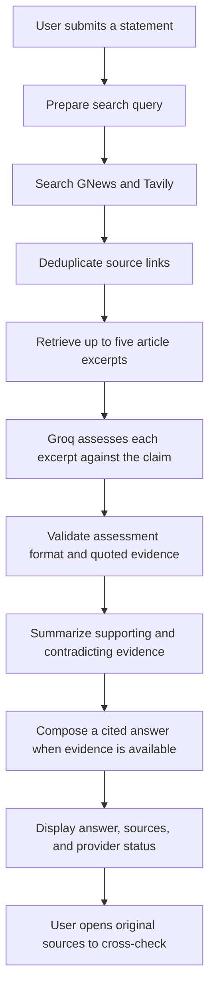

<div align="center">

# TruSight AI

### Evidence-Based News & Claim Verification

Check a statement, explore the evidence, and read a source-backed answer.

**Python · FastAPI · Groq · GNews · Tavily · HTML · CSS · JavaScript**

[Overview](#overview) · [Features](#features) · [Tech Stack](#tech-stack) · [Quick Start](#quick-start) · [API](#api) · [Deployment](#deployment)

</div>

---

## Overview

**TruSight AI** helps users investigate news headlines and factual statements by bringing relevant sources, article assessments, and a cited answer into one interface.

The application searches **GNews** and **Tavily**, retrieves article excerpts, and uses **Groq** to assess whether the evidence supports or contradicts the statement. Users can read the explanations and open the original sources to cross-check the result themselves.

This repository also preserves the project's original **Fake News Detection Using Machine Learning** research with the **LIAR** and **PolitiFact** datasets. The current web application uses live evidence retrieval and language-model analysis; the historical local classifier is a separate, optional research component.

## Features

- **Statement-based search** — turn a natural-language claim into a concise search query.
- **Two search providers** — combine news coverage from GNews with web results from Tavily, removing duplicate URLs.
- **Article-level assessments** — distinguish supporting, contradicting, unrelated, and insufficient evidence.
- **Direct, cited answers** — display a Groq-written answer above the evidence, with links to the sources used.
- **Inspectable source cards** — show titles, publishers, available dates, excerpts, and assessment explanations.
- **Conflicting evidence stays visible** — report mixed findings instead of forcing a true/false result.
- **Useful failure states** — explain missing keys, exhausted search credits, unavailable analysis, and unreadable articles.
- **Responsive interface** — a dark-themed layout with an answer card that adapts to desktop and mobile screens.
- **Server-side credentials** — provider API keys stay out of browser JavaScript and committed source files.
- **Single-service hosting** — one FastAPI application serves the interface and API on the same origin.

## Tech Stack

### Web application

| Layer | Technology | Purpose |
| --- | --- | --- |
| Language | Python 3.11 | Backend and evidence-processing logic |
| API framework | FastAPI | HTTP routes, request handling, and API documentation |
| ASGI server | Uvicorn | Run the application locally and in production |
| Validation | Pydantic | Validate statement input and enforce length limits |
| Templates | Jinja2 | Render the web interface |
| Frontend | HTML5, CSS3, vanilla JavaScript | Responsive layout, input handling, and evidence presentation |
| Browser requests | Fetch API | Call the backend without a page reload |
| News retrieval | GNews API | Find relevant news articles |
| Web retrieval | Tavily Search API | Find additional web evidence using basic search |
| Language-model inference | Groq API | Prepare queries, assess article excerpts, and compose cited answers |
| HTTP client | Requests | Communicate with providers and retrieve article pages |
| HTML extraction | Beautiful Soup 4 | Extract readable text from retrieved pages |
| Configuration | python-dotenv | Load local environment variables |
| Testing | unittest, unittest.mock | Run regression tests without external API calls |
| Hosting target | Render Python Web Service | Serve frontend and backend together |

Runtime versions are pinned in [Project_final/requirements.txt](Project_final/requirements.txt). No frontend build tool or database is required by the current application.

### Original machine-learning research

| Technology / resource | Role |
| --- | --- |
| LIAR and PolitiFact datasets | Labeled statements for classification experiments |
| pandas and NumPy | Dataset preparation and numerical operations |
| scikit-learn | TF-IDF features, preprocessing, and classification models |
| NLTK and VADER | Language processing and sentiment features |
| XGBoost | Additional classifier experiments |
| Jupyter notebooks | Exploratory analysis, training, and evaluation |
| Flask and Joblib | Separate historical LIAR prediction demo and saved artifacts |

Research dependencies are separate from production dependencies. See [requirements-research.txt](Project_final/requirements-research.txt) and the historical Flask demo's own requirements file.

## How It Works



The app can request missing context for a narrowly defined ambiguous event, such as a century scored without a match or date. General searchable statements proceed to search; the query-preparation model cannot block them with its own clarification question.

### Understanding the result

| Result | Meaning |
| --- | --- |
| **Evidence supports** | At least one assessed article supports the claim, with no assessed article contradicting it. |
| **Evidence contradicts** | At least one assessed article contradicts the claim, with no assessed article supporting it. |
| **Mixed evidence** | The assessed articles include both supporting and contradicting evidence. |
| **Insufficient evidence** | The retrieved and assessed material does not establish an answer. |
| **Needs clarification** | More event context is needed before the check proceeds. |

Supporting and contradicting assessments require an excerpt found in the retrieved text and a model assessment that the context matches. The answer's citation IDs must refer to eligible sources; mixed-evidence answers must cite both sides. If answer generation fails, the evidence summary remains available.

These labels describe the **retrieved evidence**, not guaranteed truth. The app does not display an uncalibrated confidence percentage.

## Project Structure

```text
Fake-News-Detection/
├── README.md
├── RUN_COMMANDS.md               # Setup, testing, GitHub, and Render guide
├── RUNCOMMANDS.md                # Link to the maintained run guide
├── requirements.txt              # Includes the web application's requirements
├── .gitignore
├── .python-version
└── Project_final/
    ├── app.py                    # FastAPI application and routes
    ├── verifier.py               # Search, extraction, assessment, and answers
    ├── train_model.py            # Historical local-model training script
    ├── requirements.txt          # Pinned web runtime dependencies
    ├── requirements-research.txt # Optional research dependencies
    ├── .env.example              # Blank configuration template
    ├── .python-version
    ├── templates/
    │   └── index.html            # Interface and browser interaction logic
    ├── static/
    │   └── style.css
    ├── tests/
    │   └── test_verifier.py
    ├── Liar_Dataset/
    │   └── Docker_Practise/       # Separate historical Flask demo
    └── Politifact_Dataset/
```

Original research files may also remain at the repository root to preserve the existing GitHub content. The deployable application is in `Project_final`.

## Quick Start

### Prerequisites

- Python **3.11** and Git.
- API keys for **GNews**, **Tavily**, and **Groq**.
- Internet access for live verification.

### 1. Clone and install

```bash
git clone https://github.com/Tejaramidi0118/Fake-News-Detection.git
cd Fake-News-Detection/Project_final
python3.11 -m venv .venv
source .venv/bin/activate
python -m pip install -r requirements.txt
```

On Windows PowerShell, create and activate the environment with:

```powershell
py -3.11 -m venv .venv
.\.venv\Scripts\Activate.ps1
python -m pip install -r requirements.txt
```

### 2. Configure the environment

Copy `.env.example` to `.env` and enter your keys locally. Do not overwrite an existing configured `.env`.

```dotenv
GNEWS_API_KEY=your_gnews_api_key
TAVILY_API_KEY=your_tavily_api_key
GROQ_API_KEY=your_groq_api_key
GROQ_MODEL=openai/gpt-oss-20b
```

`GROQ_MODEL` is configurable because model availability depends on the provider and account. The application uses Tavily basic search with automatic parameter upgrades disabled. Serper is no longer used.

### 3. Start the application

Run from `Project_final`:

```bash
python -m uvicorn app:app --reload --host 127.0.0.1 --port 8000
```

- **Application:** <http://127.0.0.1:8000>
- **API documentation:** <http://127.0.0.1:8000/docs>

Restart the process after changing `.env`. For troubleshooting and publishing instructions, see [RUN_COMMANDS.md](RUN_COMMANDS.md).

## API

| Method | Route | Description |
| --- | --- | --- |
| `GET` | `/` | Web interface |
| `POST` | `/verify_realtime` | Search and assess evidence for a statement |
| `GET` | `/docs` | Interactive API documentation |
| `GET` | `/redoc` | Alternative API documentation |
| `POST` | `/predict_local` | Retained experimental local-classifier endpoint |

The live-verification endpoint accepts a nonblank statement of up to **2,000 characters**:

```bash
curl --fail-with-body http://127.0.0.1:8000/verify_realtime \
  -H 'Content-Type: application/json' \
  -d '{"text":"NASA launched the James Webb Space Telescope on December 25, 2021."}'
```

Its response includes the evidence verdict, explanation, search query, provider status, source assessments, evidence counts, and answer with citations when available. Source retrieval can still succeed when another provider or answer generation is unavailable.

## Testing

From `Project_final`, with the virtual environment activated:

```bash
python -B -m unittest discover -s tests -v
python -m pip check
```

The regression suite covers provider failures, Tavily response mapping and search settings, URL deduplication, input handling, clarification regressions, quote validation, mixed evidence, and answer citation checks. Offline tests use mocked responses and do not consume provider credits.

Live integration checks have also exercised GNews, Tavily, Groq, and the cited-answer interface locally. Passing these tests verifies application behavior; it does not establish general fact-checking accuracy.

## Deployment

The application is designed for **one Render Python Web Service**. FastAPI serves the frontend and API together, keeping browser requests on the same origin and API keys on the server.

| Setting | Value |
| --- | --- |
| Root directory | `Project_final` |
| Build command | `python -m pip install -r requirements.txt` |
| Start command | `python -m uvicorn app:app --host 0.0.0.0 --port $PORT` |
| Health-check path | `/` |
| Python version | `3.11`, selected by `.python-version` |

Set `GNEWS_API_KEY`, `TAVILY_API_KEY`, `GROQ_API_KEY`, and `GROQ_MODEL` privately in Render's environment settings. Do not upload `.env` or use `--reload` in production.

A separate frontend service is unnecessary. A browser-only deployment would expose shared API credentials. External search, article retrieval, and model calls still contribute to response time.

**Deployment status:** prepared for single-service hosting; a public Render deployment has not yet been verified.

## Research Scope & Limitations

- **Live evidence, not a trained truth detector:** the current browser workflow does not use the historical local ML classifier.
- **Incomplete coverage:** search results can miss relevant evidence, and some publishers block automated article retrieval.
- **Context matters:** dates, people, locations, and specific events affect whether evidence applies to a claim. Include them when possible.
- **Model errors remain possible:** matching a quote to an article validates its origin, not the model's interpretation or the article's truthfulness.
- **Sources are not necessarily independent:** multiple articles can repeat the same underlying report. Counts are not independent confirmations.
- **Provider limits apply:** external API availability and account quotas can prevent a complete check.
- **Local ML is deferred:** the training/inference path has known serialization and input-compatibility issues. `/predict_local` returns 503 when no model is available and is not used by the frontend.
- **Historical metrics are separate:** saved notebook accuracy results describe earlier dataset experiments, not the live application's accuracy.

Keep `.env`, generated model files, virtual environments, and credentials out of Git. The repository's `.gitignore` excludes these local artifacts while retaining the blank `.env.example` template.
